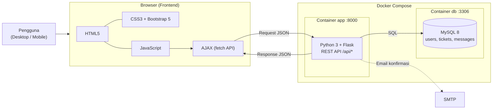

<p align="center">
  <picture>
    <source media="(prefers-color-scheme: dark)" srcset="mockup/assets/logo-mark-white.svg">
    
  </picture>
</p>

<h1 align="center">Tavrena</h1>

<p align="center">Helpdesk ticketing berbasis web · <a href="https://tavrena.afatyo.web.id">Lihat mockup</a></p>

**Tavrena** adalah aplikasi helpdesk ticketing berbasis web. Pengguna bisa membuat tiket keluhan, agent menangani tiket sesuai level akses, dan semua percakapan tersimpan sebagai riwayat pesan. Tampilan dibuat responsif untuk desktop dan mobile.

## Latar Belakang Masalah

Banyak tim support kecil masih menerima keluhan lewat chat pribadi, email terpisah, atau spreadsheet. Akibatnya:

- Keluhan tercecer dan sulit dilacak statusnya.
- Tidak ada prioritas yang jelas, keluhan kritis bisa tertangani belakangan.
- Riwayat percakapan dengan pelanggan hilang saat agent berganti.
- Tidak ada pembagian hak akses antara admin, manajer, dan agent.

Tavrena menyatukan semua keluhan dalam satu sistem tiket dengan status, tingkat severity, riwayat pesan, dan hak akses berlapis.

## Fitur Aplikasi

| Fitur | Keterangan |
|---|---|
| Registrasi akun + konfirmasi link | Akun baru aktif setelah pengguna klik link verifikasi di email |
| Riwayat pesan | Setiap tiket punya thread percakapan antara pengguna dan agent |
| Ringkasan tiket per severity | Dashboard menampilkan jumlah tiket per severity: **High**, **Medium**, **Low** |
| Status tiket | Alur status: **Open → Pending → Complete** |
| Hak akses agent | Tiga level: **Super Admin**, **Manager**, **Agent** |
| Antarmuka responsif | Layout desktop (sidebar) dan mobile (bottom nav / offcanvas) |
| CRUD tiket | Tampil, tambah, ubah, hapus tiket |
| Pencarian dan filter | Cari kata kunci, filter status, severity, dan agent |

### Hak Akses

| Aksi | Super Admin | Manager | Agent |
|---|:---:|:---:|:---:|
| Kelola user dan role | ✅ | ❌ | ❌ |
| Assign tiket ke agent | ✅ | ✅ | ❌ |
| Ubah status tiket | ✅ | ✅ | ✅ (tiket miliknya) |
| Hapus tiket | ✅ | ✅ | ❌ |
| Lihat laporan ringkasan | ✅ | ✅ | ✅ (tiket miliknya) |

## Teknologi

| Lapisan | Teknologi |
|---|---|
| Struktur halaman | HTML5 |
| Tampilan | CSS3 + Bootstrap 5 |
| Interaksi | JavaScript (vanilla) |
| Komunikasi data | AJAX (`fetch` API) |
| Format data | JSON |
| Backend | Python 3 + Flask (REST API sederhana) |
| Database | MySQL 8 |
| Container | Docker + Docker Compose |

### Arsitektur Stack




## Desain

Mockup statis bisa dibuka di **https://tavrena.afatyo.web.id** (source di folder [`mockup/`](mockup/)).

| Halaman | Isi |
|---|---|
| [Login](https://tavrena.afatyo.web.id/login.html) | Masuk, validasi form, daftar akun dengan konfirmasi link email |
| [User](https://tavrena.afatyo.web.id/user.html) | Daftar tiket per status, buat tiket, riwayat pesan |
| [Agent](https://tavrena.afatyo.web.id/staff.html) | Antrean urut prioritas, balas pesan, ubah status |
| [Manager](https://tavrena.afatyo.web.id/manager.html) | Ringkasan severity, beban per agent, assign, cari dan filter tiket |
| [Super Admin](https://tavrena.afatyo.web.id/admin.html) | Kelola user, role, dan permission |

### Palet warna

Semua warna dipakai solid, tanpa gradasi.

| Warna | Kode | Dipakai untuk |
|---|---|---|
| Blanche White | `#FEFFFC` | Latar halaman, sidebar, kartu |
| Ink | `#0A0A0D` | Teks, garis tepi, bayangan |
| Plum Violet | `#8116E0` | Kotak ringkasan, status Open, bubble chat agent, link |
| Banana Yellow | `#D0FF00` | Menu aktif, tombol utama, status Complete, severity Low |

Warna severity: High `#E5213F`, Medium `#FFB020`, Low `#D0FF00`.

### Tipografi dan gaya

- **Bricolage Grotesque** untuk judul, angka, dan teks utama.
- **IBM Plex Mono** untuk nomor tiket, label, waktu, dan badge.
- Gaya brutalist bertema tiket: sudut tegas, garis tepi 1.5px, bayangan solid tanpa blur, kartu tiket bertakik, dan garis putus-putus seperti perforasi karcis.

### Logo

<picture>
    <source media="(prefers-color-scheme: dark)" srcset="mockup/assets/logo-mark-white.svg">
    
  </picture>

Logo **Tiles**: empat ubin tiket, satu bergeser keluar sebagai tiket yang sedang ditangani. File ada di [`mockup/assets/`](mockup/assets/): `logo-mark.svg` untuk latar terang, `logo-mark-white.svg` untuk latar gelap atau violet, versi beranimasi `logo-mark-animated.svg` dan `logo-mark-white-animated.svg`, serta `favicon.svg`. Referensi logo lain ada di [`mockup/logo-referensi/`](https://tavrena.afatyo.web.id/logo-referensi/preview.html).

## Penerapan Logika dan Algoritma

- **Percabangan (`if/else`)**: cek role sebelum menampilkan menu, transisi status yang valid, badge warna severity.
- **Perulangan (`for/while`)**: render daftar tiket dan riwayat pesan dari array JSON, hitung ringkasan per severity.
- **Fungsi**: modul `api.js` (request AJAX), `validator.js`, `render.js`.
- **Validasi data**: email valid, password minimal 8 karakter, judul dan deskripsi tiket wajib, severity harus salah satu dari daftar.
- **Algoritma inti**:
  - *Prioritas antrean*: tiket diurutkan berdasarkan bobot severity (High=3, Medium=2, Low=1) lalu umur tiket.
  - *Auto assign*: tiket baru diberikan ke agent dengan jumlah tiket Open paling sedikit (round robin berbasis beban).
  - *Transisi status*: hanya boleh Open → Pending → Complete, atau Pending → Open saat pengguna membalas.

## Contoh AJAX + JSON

```js
// Ambil daftar tiket dengan filter, tanpa reload halaman
async function loadTickets(filter) {
  const params = new URLSearchParams(filter);
  const res = await fetch(`/api/tickets?${params}`);
  const data = await res.json();
  renderTickets(data.tickets);
}
```

Respons JSON:

```json
{
  "status": "success",
  "tickets": [
    { "id": 12, "title": "Email tidak bisa login", "severity": "High", "status": "Open", "agent": "Fikri" }
  ]
}
```

## Struktur Folder (rencana)

```
tavrena/
├── index.html            # login
├── register.html
├── dashboard.html
├── tickets.html
├── ticket-detail.html
├── users.html
├── assets/
│   ├── css/style.css
│   └── js/ (api.js, validator.js, render.js, app.js)
├── mockup/               # mockup statis (HTML, CSS, JS, data dummy, logo)
├── app.py                # server Flask, endpoint /api/*, keluaran JSON
├── requirements.txt
├── Dockerfile            # image backend Flask
├── docker-compose.yml    # service app + db (MySQL)
├── .env.example          # variabel DB, SMTP, secret
├── database/schema.sql
└── docs/                 # dokumen, flowchart, desain UI
```

## Tim

| Peran | Nama | Tanggung Jawab |
|---|---|---|
| Project Manager | Muhammad Afatyo Ikhsan | Jadwal, koordinasi tim, review, dokumen deskripsi proyek |
| UI/UX Designer | Devani Arlenia | Wireframe, mockup desktop dan mobile, design system |
| Frontend Developer | Fikri Nabhan | HTML, CSS, Bootstrap, JavaScript, integrasi AJAX |
| Backend Developer | Zalfa Aisyah Putri | Database, REST API Python (Flask), auth, konfirmasi email |
| System Analyst | Said Anwari | Analisis kebutuhan, flowchart, ERD, dokumentasi AJAX/JSON, pengujian |

## Timeline (1 Bulan)

| Minggu | Tanggal | Fokus | Output |
|---|---|---|---|
| 1 | 24 – 30 Nov 2026 | Analisis dan desain | Dokumen deskripsi proyek, pembagian tugas, flowchart, ERD, wireframe |
| 2 | 1 – 7 Des 2026 | Fondasi | Mockup final, schema database, auth + konfirmasi link, layout dasar |
| 3 | 8 – 14 Des 2026 | Fitur inti | CRUD tiket, riwayat pesan, status, severity, role, pencarian dan filter |
| 4 | 15 – 21 Des 2026 | Finalisasi | Dashboard ringkasan, mobile polish, pengujian, dokumentasi AJAX/JSON, presentasi |

Rincian task ada di GitHub Project **Tavrena Roadmap**.

## Deliverable

1. Dokumen deskripsi proyek dan latar belakang masalah
2. Pembagian tugas anggota kelompok
3. Flowchart / diagram alur algoritma
4. Desain antarmuka aplikasi
5. Source code aplikasi
6. Dokumentasi penerapan AJAX dan JSON

## Menjalankan Secara Lokal

```bash
git clone https://github.com/afatyoo/tavrena.git
cd tavrena
cp .env.example .env
docker compose up -d --build
```

Service yang jalan:

| Service | Isi | Port |
|---|---|---|
| `app` | Flask (API + file HTML statis) | 8000 |
| `db` | MySQL 8, `database/schema.sql` otomatis di-import saat pertama jalan | 3306 |

Perintah berguna:

```bash
docker compose logs -f app   # lihat log backend
docker compose down          # hentikan semua service
```

Buka `http://localhost:8000`.
